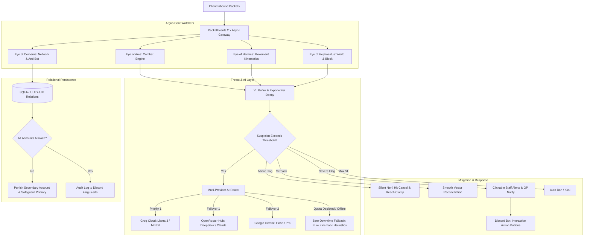

<p align="center">
  
</p>

# ArgusAC — The All-Seeing Guardian

[](https://github.com/ShaikhZaid404/ArgusAC/actions/workflows/build.yml)
[](https://www.gnu.org/licenses/gpl-3.0)
[](https://papermc.io)
[](https://adoptium.net)
[](https://modrinth.com/plugin/argusac)

> **"The 100-Eyed All-Seeing Guardian for Modern Minecraft Servers."**

ArgusAC is an enterprise-grade, high-performance anti-cheat, threat intelligence, and server security plugin engineered from the ground up for **Paper, Purpur, and Folia** servers (Minecraft 1.21.x). It bridges deterministic, sub-tick kinematic physics simulation with an autonomous, multi-provider AI decision engine (Groq, OpenRouter, Gemini), zero-downtime hot reloading, intelligent alt-account enforcement, and interactive Discord operations.

---

## 🌟 Why ArgusAC?

Most traditional anti-cheats struggle with three fundamental flaws:
1. **False Positives on Lag**: They rely on rigid thresholds that flag legitimate players when server TPS dips or network ping spikes.
2. **AI Hardcoding & Quota Crashes**: Existing AI-powered plugins hardcode specific model names that break when providers update their APIs, or they completely halt server security when API rate limits (`HTTP 429`) occur.
3. **Severe Runtime I/O Lag**: Repeatedly reading configuration files and prompt templates from disk during fast-paced PvP causes thread stalls and tick drops.

**ArgusAC solves all three:**
- **Dynamic AI Model Discovery**: Queries `/v1/models` every 24 hours to automatically adapt to provider catalog changes with zero hardcoding.
- **Failover Routing & Pure Math Fallback**: If an API quota is depleted or internet access drops, ArgusAC seamlessly falls back to pure internal kinematic heuristics without a millisecond of security downtime.
- **Pre-Loaded Prompt Memory Caching**: All four efficiency prompt tiers are loaded directly into RAM at startup, eliminating runtime disk I/O.
- **Native Folia Multithreading**: Full support for Folia regionised threading and Java 21 virtual threads, keeping your server running at a locked 20.0 TPS.

---

## 🧱 Architecture Overview



---

## 🛡️ Core Detection Watchers ("The Eyes of Argus")

### 1. Eye of Ares (Combat Watcher)
* **KillAura & AimAssist**: Validates rotation angles using mouse sensitivity Greatest Common Divisor ($GCD$) math ($GCD = \text{sensitivity} \times 0.15$). Detects synthetic smooth aimbots and silent snaps that violate natural human movement.
* **Reach Raycasting**: Evaluates eye-to-target distance against target oriented bounding boxes (OBB) with sub-tick ping rewind. Attacks exceeding 3.01 blocks are flagged and silently cancelled.
* **AutoClicker Cadence**: Analyzes rolling click intervals (CPS) over 1000ms windows. Evaluates standard deviation and kurtosis to identify artificial auto-clickers with uniform jitter.
* **Velocity & Anti-KB**: Compares expected server-side knockback impulse vectors against actual received client motion packets.

### 2. Eye of Hermes (Movement Watcher)
* **Fly & Glide**: Compares vertical motion deltas ($\Delta Y$) against vanilla gravity ($g = 0.08$) and drag ($0.98$). Detects mid-air hovering, illegal ascent, and glide anomalies.
* **Speed Kinematics**: Enforces physical horizontal distance limits ($\sqrt{\Delta X^2 + \Delta Z^2}$) taking sprint-jumping, block friction (ice, slime, soul sand), and potion effect amplifiers into account.
* **Scaffold & Tower**: Evaluates placement pitch snaps ($> 72^\circ$), elevation differences, and backwards-sprinting placements. Illegal blocks are automatically cancelled before world update.
* **Timer**: Tracks client game clock packet timestamps against server tick elapsed milliseconds to prevent fast-forwarding hacks.

### 3. Eye of Cerberus (Identity & Alt-Account Manager)
ArgusAC maintains an internal relational database tracking `UUID <-> Username <-> IP <-> First Seen Timestamp <-> Trust Score`:
* **Strict Primary Account Safeguard**: The first account to ever connect from an IP is permanently designated as the **Primary Account** (e.g. `zaid1`).
* **Configurable Secondary Punishments**: If `alts.allowed: false` is configured, subsequent accounts attempting to connect from the same IP (e.g. `zaid2`) receive your chosen punishment:
  * `KICK` — Immediate disconnect with custom notification.
  * `TEMPBAN` — Automatic timed ban (e.g. `7d`, `14d`, `30d`).
  * `BAN` — Permanent network ban.
  * `COMMAND` — Execution of your server's punishment manager command (e.g. LiteBans, AdvancedBan).
* **In-Game Online Alert**: If the primary account (`zaid1`) is online when their alt tries to connect, they receive an immediate in-game notification:
  `[ArgusAC] Notice: A secondary account (zaid2) attempted to connect from your IP and was rejected.`

### 4. Eye of Apollo (Autonomous AI & Behavioral Intelligence)
* **Dynamic Model Discovery**: Scans `/v1/models` every 24 hours across Groq, OpenRouter, and Gemini. If a provider retires a model, ArgusAC automatically elects the next optimal model in RAM without requiring plugin updates.
* **Resilient Failover**: If Groq returns `HTTP 429 (Rate Limit)`, traffic instantly reroutes to OpenRouter or Gemini. If all providers are offline, ArgusAC engages **Pure Kinematic Heuristics** with zero interruption.
* **In-Memory Prompt Tiers**: Pre-loads four efficiency tiers (`LOW`, `MEDIUM`, `HIGH`, `EXTRA_HIGH`) into RAM on startup, swappable on the fly using `/argus efficiency <tier>`.

---

## 🎮 Command Suite & Permissions

ArgusAC provides a master administrative command `/argus` (aliases: `/argusac`, `/ac`, `/guardian`).

### Command Table

| Command | Arguments | Permission | Description |
|---|---|---|---|
| `/argus guide` | None | `argus.admin` | Gives the interactive in-game written setup book. |
| `/argus status` | None | `argus.admin` | Displays live engine diagnostics, active AI model, and latency. |
| `/argus reload` | `[all \| ai \| discord]` | `argus.admin` | Executes zero-downtime hot reload of configs, keys, and prompts. |
| `/argus freeze` | `<player>` | `argus.mod` | Locks suspect movement, displays freeze screen, and starts timer. |
| `/argus unfreeze` | `<player>` | `argus.mod` | Releases a frozen player from investigation. |
| `/argus alts` | `<player \| ip>` | `argus.mod` | Lists all registered accounts sharing an IP or associated with a player. |
| `/argus efficiency` | `<low \| medium \| high \| extra_high>` | `argus.admin` | Hot-swaps the active AI system prompt in RAM memory. |
| `/argus inspect` | `<player>` | `argus.mod` | Toggles real-time action-bar metrics and raycast overlay on suspect. |
| `/argus dump` | `<player>` | `argus.mod` | Generates a formatted forensic incident report of recent flags. |
| `/argus bypass` | `<player> [duration]` | `argus.admin` | Grants temporary exemption from detection checks. |
| `/argus alerts` | None | `argus.alerts` | Toggles in-game cheat violation notifications for staff. |
| `/argus vl` | `<player>` | `argus.mod` | Displays current violation levels and buffer decay status. |
| `/argus reset` | `<player>` | `argus.admin` | Resets a player's violation levels and suspicion score to 0. |

### Permissions Hierarchy

| Permission Node | Description | Default |
|---|---|---|
| `argus.admin` | Full administrative control over all ArgusAC commands, configs, and reload. | `op` |
| `argus.mod` | Access to moderator utilities: freeze, unfreeze, alts lookup, inspect, and VL view. | `op` |
| `argus.alerts` | Receive real-time clickable cheat alerts and action-bar flag notifications. | `op` |
| `argus.bypass` | Complete exemption from all anti-cheat detection routines. | `false` |
| `argus.alts.bypass` | Exemption from the primary-account alt enforcement policy. | `false` |

---

## 👮 Staff Experience & In-Game Utilities

### 1. Interactive Clickable Chat Alerts
When a violation occurs, staff members receive rich chat alerts with one-click actions:
```text
[Argus] Player123 flagged KillAura (Type A: GCD Mismatch) [VL: 14] | [TP] [INSPECT] [FREEZE] [BAN]
```
* **`[TP]`**: Teleports staff directly behind the suspect.
* **`[INSPECT]`**: Engages first-person mirror and action-bar live metrics.
* **`[FREEZE]`**: Locks the suspect's screen and issues a Discord verification code.
* **`[BAN]`**: Pre-fills the configured ban command into the staff member's chat bar.

### 2. Interactive Setup Guide Book (`/argus guide`)
Running `/argus guide` delivers an in-game written book (`ItemStack`) with clickable links:
- **Page 1**: Live System Checklist (`[✔] Core Checks: ACTIVE`, `[✔] Database: SQLite OK`, `[✔] Prompts: 4 in RAM`).
- **Page 2**: AI Setup links (clickable links to Groq Console, OpenRouter Hub, and Google AI Studio).
- **Page 3**: Discord bot setup instructions and command reference.

### 3. Screen-Share Freeze System (`/argus freeze <player>`)
- Locks the suspect at their current coordinates.
- Displays full-screen title: `FROZEN BY STAFF` with subtitle `Do NOT disconnect! Join Discord & run /verify ARG-XXXX`.
- If the player disconnects before verification or the 5-minute timer expires, ArgusAC automatically bans the account for **Screen-Share Evasion**.

### 4. Console Startup Banner
Upon server startup, ArgusAC prints a clean ASCII banner to the console:
```text
  ___                           _    ____ 
 / _ \                         | |  / ___|
/ /_\ \ _ __  __ _  _   _  ___ | | / /___ 
|  _  || '__/ _` || | | |/ __|| | | ___ \
| | | || | | (_| || |_| |\__ \| | | \_/ |
\_| |_/|_|  \__, | \__,_||___/|_| \_____/
             __/ |                        
            |___/   [The All-Seeing Guardian]
--------------------------------------------------
 > Engine: Paper / Purpur / Folia 1.21 (Region-Threaded)
 > Version: v1.0.0 (Java 21)
 > AI Engine: Dynamic Discovery (Groq / OpenRouter / Gemini)
 > Pure Kinematic Fallback: Armed & Ready
 > Alt Protection: SQLite Relational Primary Ledger
--------------------------------------------------
```

---

## 📁 Configuration File Architecture

ArgusAC divides settings into four isolated configuration files:

| File | Purpose |
|---|---|
| **`config.yml`** | Check modules, thresholds, physics simulation, alt policy, and mitigation settings. |
| **`messages.yml`** | All in-game messages, chat formats, prefixes, colors, and OP welcome banners. |
| **`discord.yml`** | Discord bot settings, channel snowflake IDs, staff roles, and interactive buttons. |
| **`secrets.yml`** | **Sensitive tokens only** (Groq Key, OpenRouter Key, Gemini Key, Discord Token, DB Password). Strictly `.gitignore` protected! |

---

## ⚡ Quick Start

1. Ensure your server is running **Java 21** and **Paper / Purpur / Folia 1.21.x**.
2. Download the verified release JAR exclusively from [Modrinth](https://modrinth.com/plugin/argusac).
3. Place `ArgusAC-1.0.0-all.jar` inside your server's `plugins/` directory.
4. Start the server once to generate initial configuration files.
5. Open `plugins/ArgusAC/secrets.yml` and insert your preferred AI API key(s) and Discord Bot token.
6. In game, run `/argus reload` to load all keys instantly with **zero downtime**.
7. An operator joining the server will receive the live status summary banner or can run `/argus guide` to inspect system readiness.

---

## 🔨 Building From Source (Gradle)

ArgusAC is built using **Gradle (Kotlin DSL)** and the Shadow plugin:

```bash
# Clone the open-source repository
git clone https://github.com/ShaikhZaid404/ArgusAC.git
cd ArgusAC

# Build clean shaded production JAR
./gradlew clean shadowJar
```

On Windows:
```cmd
gradlew.bat clean shadowJar
```

The compiled and shaded plugin JAR will be produced in:
```text
build/libs/ArgusAC-1.0.0-all.jar
```

---

## 📦 Distribution & Licensing

- **Source Code**: 100% Free and Open-Source on GitHub under the **GNU General Public License v3.0 (GPLv3)**.
- **Binary Releases**: Pre-compiled, signed release JARs are distributed **exclusively on Modrinth** to guarantee security, integrity, and anti-malware verification.
- **Code Craftsmanship**: Zero synthetic AI boilerplate; fully human-architected idiomatic Java 21 adhering to Modrinth publishing standards.
