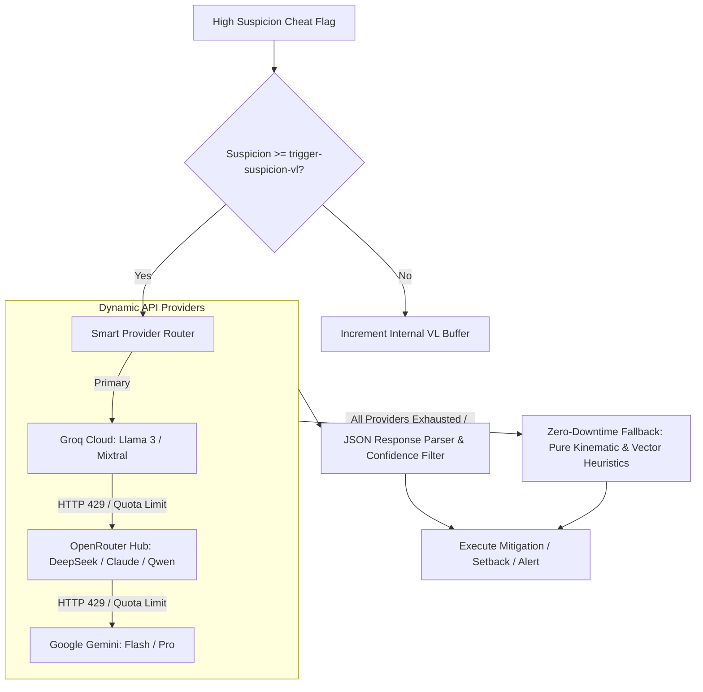

# ArgusAC AI Engine & Failover Architecture

ArgusAC features an autonomous, multi-provider AI decision engine designed to eliminate the risks of rate-limiting, hardcoded model deprecation, and server latency.

---

## 1. Multi-Provider Resiliency Architecture



---

## 2. Dynamic Model Discovery (`default-model: auto`)

Most anti-cheat AI implementations break when an external provider renames or deprecates a model. ArgusAC eliminates hardcoded models entirely:

1. **Autonomous Discovery**:
   - At startup and every **24 hours**, ArgusAC asynchronously queries the `/v1/models` endpoint for every active API key in `secrets.yml`.
   - It filters available models by token limits, context window, and latency metrics.
2. **Dynamic Ranking**:
   - If `default-model: "auto"` is configured, ArgusAC automatically elects the optimal model based on available quota, lowest response latency, and throughput.
3. **Resilience**:
   - If an AI provider retires a free model, the 24-hour discovery cycle seamlessly shifts to the next viable candidate without requiring plugin updates.

---

## 3. Graceful Fallback to Pure Kinematics

If your server experiences an internet outage, an invalid API key, or all AI provider quotas are depleted:
- ArgusAC **never halts protection**.
- It instantly engages **Pure Kinematic & Vector Mode**.
- Checks fall back to internal mathematical boundaries ($GCD$, bounding-box raytracing, and kinematic acceleration formulas).
- Your server remains 100% shielded while logging a warning to staff:
  `[Argus] Notice: AI providers offline. Pure Kinematic Heuristics engaged.`

---

## 4. Pre-Loaded Prompt Memory Caching (`argusai-prompts/`)

To prevent synchronous disk reads during fast-paced PvP combat, all system prompts are pre-loaded into Java RAM at startup:

| Profile | File | Primary Use Case | Output Complexity |
|---|---|---|---|
| `LOW` | `low-system.md` | High player counts / budget APIs | Strict JSON verdict + confidence only. |
| `MEDIUM` | `medium-system.md` | Standard balanced production | Verifies kinematics against latency/TPS. |
| `HIGH` | `high-system.md` | Competitive PvP & ghost client detection | Deep GCD, rotation variance, and click entropy. |
| `EXTRA_HIGH` | `extra-high-system.md` | High-risk forensic investigations | Alt-account correlation & cross-session profiling. |

### Hot-Swapping Efficiency In-Game
Administrators can switch the active efficiency tier on the fly without server restart:
```text
/argus efficiency high
```
The active prompt pointer in RAM switches instantly in `0ms`.
