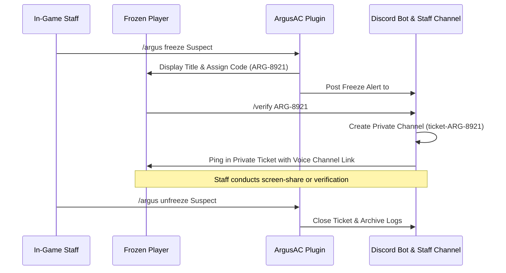

# ArgusAC Discord Integration Guide

ArgusAC features an integrated Discord bot and webhook system that turns your Discord server into a remote Security Operations Center (SOC).

---

## 1. Operating Modes

In `plugins/ArgusAC/discord.yml`, configure your preferred mode:

### Mode A: Full JDA Bot (`mode: "BOT"`)
- Requires a Discord Bot token configured in `secrets.yml`.
- Enables interactive Discord buttons on alerts, slash commands, and automated freeze verification tickets.
- Ideal for servers with an active staff team.

### Mode B: Lightweight Webhook (`mode: "WEBHOOK"`)
- Only requires a Discord Webhook URL.
- Uses zero extra background threads and zero bot gateway connections.
- Sends high-speed, clean alert embeds without remote interactive buttons.

---

## 2. Interactive Message Buttons

When `mode: "BOT"` is active, violation alerts sent to your staff alert channel include Discord button components:

```text
+-------------------------------------------------------------+
| 🔴 [Argus] Severe Combat Violation Detected                 |
| Player: Player123 (Ping: 42ms | TPS: 20.0)                  |
| Check: KillAura [Type A - GCD Rotation Inconsistency]       |
| VL: 18 | Threat Score: 84/100                               |
| AI Verdict: CHEATING (Confidence: 96%)                      |
+-------------------------------------------------------------+
| [🔴 Ban Player] [🟡 Kick] [❄️ Freeze] [📋 Lookup] [❌ Dismiss]|
+-------------------------------------------------------------+
```

Staff with the configured `staff-admin` role can click buttons directly from mobile or desktop:
* **[🔴 Ban Player]**: Immediately executes the configured server ban command.
* **[🟡 Kick]**: Removes the player from the active game session.
* **[❄️ Freeze]**: Triggers the in-game freeze screen and issues a verification ticket.
* **[📋 Lookup]**: Replies with an embed containing the player's historical flags and linked alt accounts.
* **[❌ Dismiss]**: Acknowledges the alert and marks the embed as reviewed.

---

## 3. Screen-Share Ticket Workflow (`/verify`)



If the frozen player disconnects from Minecraft before verification or allows the 5-minute timer to expire, ArgusAC automatically bans the account for **Screen-Share Evasion**.

---

## 4. Anti-Spam Smart Batching

When a player triggers continuous violations (e.g. 30 Fly flags in 4 seconds):
- Traditional anti-cheats flood the Discord channel with 30 separate messages, triggering Discord API 429 rate limits.
- **ArgusAC Smart Batching** maintains a single active message per player session and edits the existing embed in real-time:
  `VL: 1 ➔ 5 ➔ 14 ➔ 30 [Status: ACTIVE VIOLATION]`
- Once the violation ceases or the player is punished, the embed border turns green/resolved.

---

## 5. Daily Automated Threat Digest

Every midnight (or at a scheduled UTC hour), ArgusAC publishes an analytics briefing to your `#daily-digest` channel:
* Total unique connections verified.
* Total combat/movement flags prevented.
* Top 3 flagged infractions of the day.
* Bot attack volume mitigated.
* Alt-account connection audits.
